:::::: {.hero}
::::: {.hero-inner .hero-single}
:::: {.hero-copy}
```{=html}
<h1 class="hero-name">Jacob Willson</h1>
```

AI research fellow at the Air Force Research Laboratory. Over ten years in business intelligence and data analytics at New Balance, Forrester Research, and in consulting; now building data pipelines, LLM and agent evaluations, and GPU inference infrastructure.

<p class="hero-meta">M.S. Data Science and Analytics, SUNY Polytechnic Institute, May 2027 · Clinton, New York</p>

[Projects](#projects){.btn .btn-primary} [Experience](about.qmd){.btn .btn-outline-dark}
::::
:::::
::::::

:::::: {#projects .section-shell .projects-shell}
<nav class="jump-row" aria-label="Project groups"><span>Projects</span><a href="#analytics-engineering">Analytics engineering</a><a href="#decision-science">Decision science</a><a href="#applied-ai">Applied AI</a></nav>

<p class="projects-note">Each card links to a repository with the code, data or data generator, results, and stated limitations. Select a figure to enlarge it.</p>

::::: {#analytics-engineering .project-group}
## Analytics Engineering and Data Platforms

:::: {.project-grid .project-grid-wide}
::: {.project-card}
```{=html}
<a class="project-figure lightbox" href="assets/img/projects/agent-ready-dashboard.webp" data-gallery="agent-ready" data-description="LangSmith dashboard built from code: accuracy by model and context, hard questions, and the context fix.">
  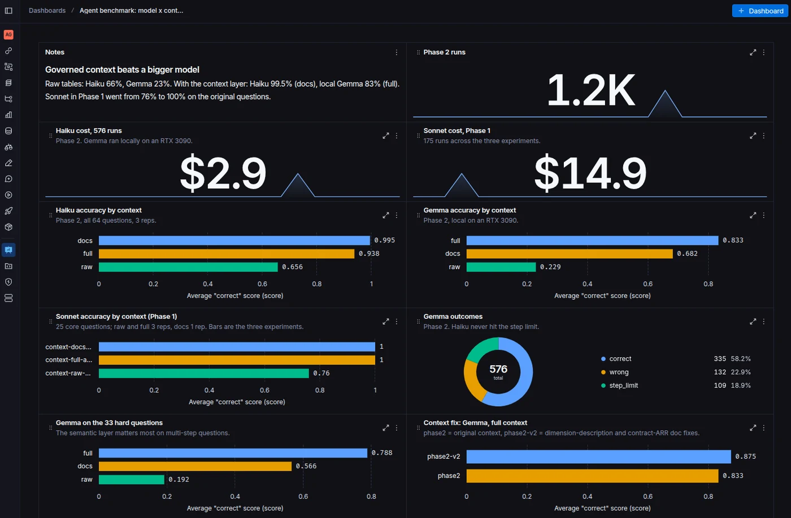
  <span class="figure-count">3 figures</span>
</a>
<a class="lightbox" href="assets/img/projects/agent-ready.webp" data-gallery="agent-ready" data-description="Accuracy by context level for Claude Haiku 5.5 and local Gemma 4 26B, on original and hard questions, with 95% intervals." hidden aria-hidden="true"></a>
<a class="lightbox" href="assets/img/projects/agent-ready-defect.webp" data-gallery="agent-ready" data-description="A LangSmith trace of the context defect: the agent groups a governed metric by a dimension that reports current state, not September." hidden aria-hidden="true"></a>
```

<p class="project-type">Analytics engineering · Agent evaluation · Semantic layer</p>

### Agent-Ready Analytics

A benchmark measuring how much a governed context layer of dbt docs, a MetricFlow semantic layer, and business guides changes a data agent's accuracy, cost, and latency, run on BigQuery against a synthetic SaaS company with 13 planted data traps.

<div class="project-result"><span>Key finding</span><strong>With full context, local Gemma 4 26B went from 23% to 83% accuracy across 1,152 scored runs, and its gap to Claude Haiku 5.5 shrank from 43 points to 10. The eval traced the remaining errors to defects in the context layer itself.</strong></div>

<p class="project-tools">BigQuery · dbt · MetricFlow · LangGraph · LangSmith · Ollama</p>

[View repository →](https://github.com/JacobWillson13/agent-ready-analytics)
:::

::: {.project-card}
```{=html}
<a class="project-figure lightbox" href="assets/img/projects/seats-to-cash.webp" data-gallery="seats-to-cash" data-description="Streamlit app: month-end ARR, 2026 ARR movements by type, and billings vs revenue vs cash.">
  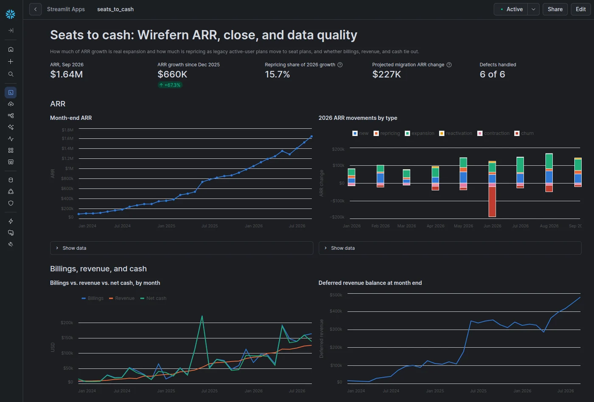
  <span class="figure-count">3 figures</span>
</a>
<a class="lightbox" href="assets/img/projects/seats-to-cash-lineage.webp" data-gallery="seats-to-cash" data-description="dbt lineage from Orb, Stripe, and Salesforce sources to the ARR marts." hidden aria-hidden="true"></a>
<a class="lightbox" href="assets/img/projects/seats-to-cash-hightouch.webp" data-gallery="seats-to-cash" data-description="Hightouch sync of the account-signals model to the Salesforce Account object." hidden aria-hidden="true"></a>
```

<p class="project-type">Analytics engineering · Financial data · Reconciliation</p>

### Seats-to-Cash

A dbt and Snowflake finance stack on synthetic Orb, Stripe, and Salesforce data that reconciles billings, revenue, deferred revenue, and cash, and syncs account signals to Salesforce via Hightouch.

<div class="project-result"><span>Key finding</span><strong>15.7% of 2026 ARR growth was repricing rather than expansion, with every MRR and revenue figure matching the answer key to the cent.</strong></div>

<p class="project-tools">dbt · Snowflake · DuckDB · Hightouch · Streamlit · LookML</p>

[View repository →](https://github.com/JacobWillson13/seats-to-cash)
:::

::: {.project-card}
```{=html}
<a class="project-figure lightbox" href="assets/img/projects/adventureworks-dashboard.webp" data-gallery="adventureworks" data-description="Overview page of the five-page Databricks AI/BI dashboard, deployed from JSON in the repository.">
  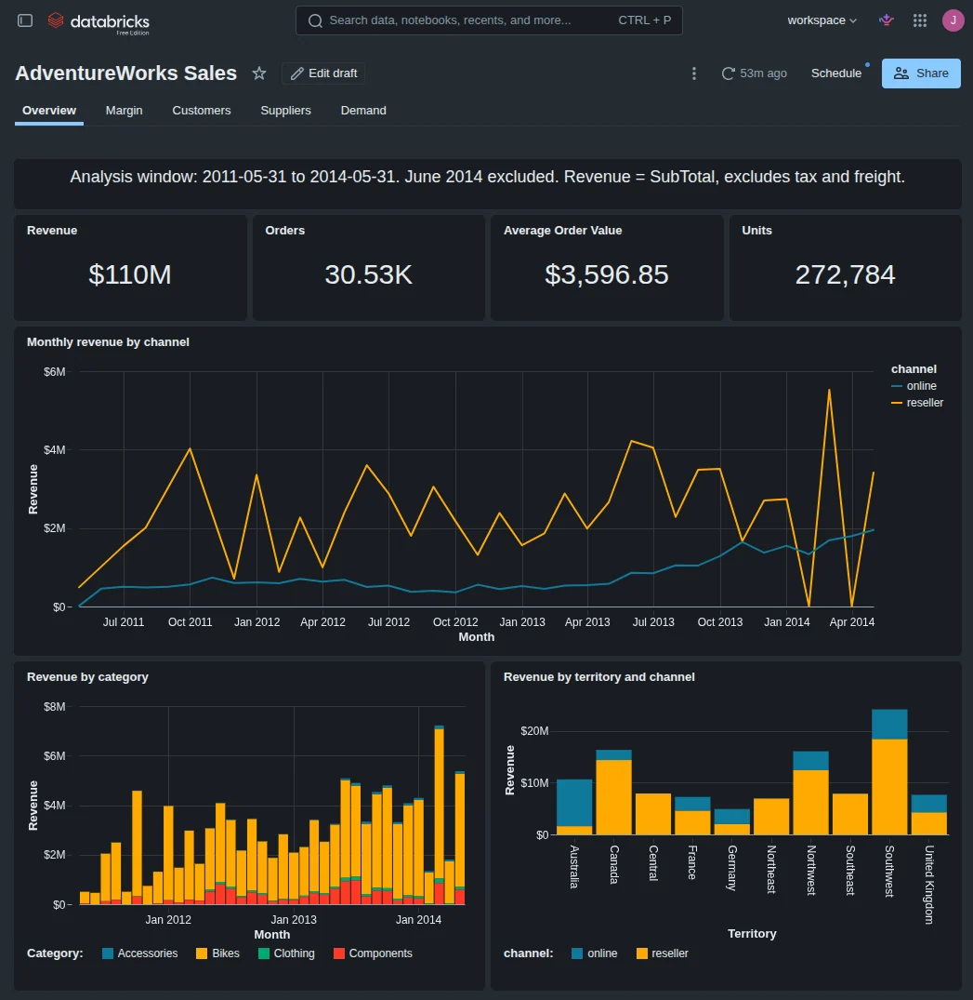
  <span class="figure-count">4 figures</span>
</a>
<a class="lightbox" href="assets/img/projects/adventureworks.webp" data-gallery="adventureworks" data-description="Monthly revenue and orders by channel. Shaded months had no reseller batch; the July 2013 online expansion shows in order counts." hidden aria-hidden="true"></a>
<a class="lightbox" href="assets/img/projects/adventureworks-margin.webp" data-gallery="adventureworks" data-description="Gross margin over time: total, by category, and by channel, from cost history joined by effective date." hidden aria-hidden="true"></a>
<a class="lightbox" href="assets/img/projects/adventureworks-segments.webp" data-gallery="adventureworks" data-description="Customer segments: share of customers vs share of revenue, and recency vs value." hidden aria-hidden="true"></a>
```

<p class="project-type">Data engineering · Lakehouse · Analytics</p>

### AdventureWorks Lakehouse

A Databricks medallion lakehouse that turns a broken 72-file export into a dbt star schema with 148 tests, MLflow-tracked analyses, and a five-page AI/BI dashboard, deployed as one Asset Bundle.

<div class="project-result"><span>Key finding</span><strong>Resellers bring about three quarters of revenue at a 0.6% gross margin, while online holds a steady 40%. Forecasting did not beat a naive baseline (49.0% vs 49.4% WAPE), and the write-up reports that rather than hiding it.</strong></div>

<p class="project-tools">Databricks · PySpark · Lakeflow · dbt · MLflow · AI/BI dashboards</p>

[View repository →](https://github.com/JacobWillson13/adventureworks-lakehouse)
:::

::: {.project-card}
```{=html}
<a class="project-figure lightbox" href="assets/img/projects/nfip-crs.webp" data-gallery="nfip-crs" data-description="Overview page of the Databricks AI/BI dashboard, deployed from code in the repository: each CRS class's loss cost against its break-even discount, and CRS participation by state.">
  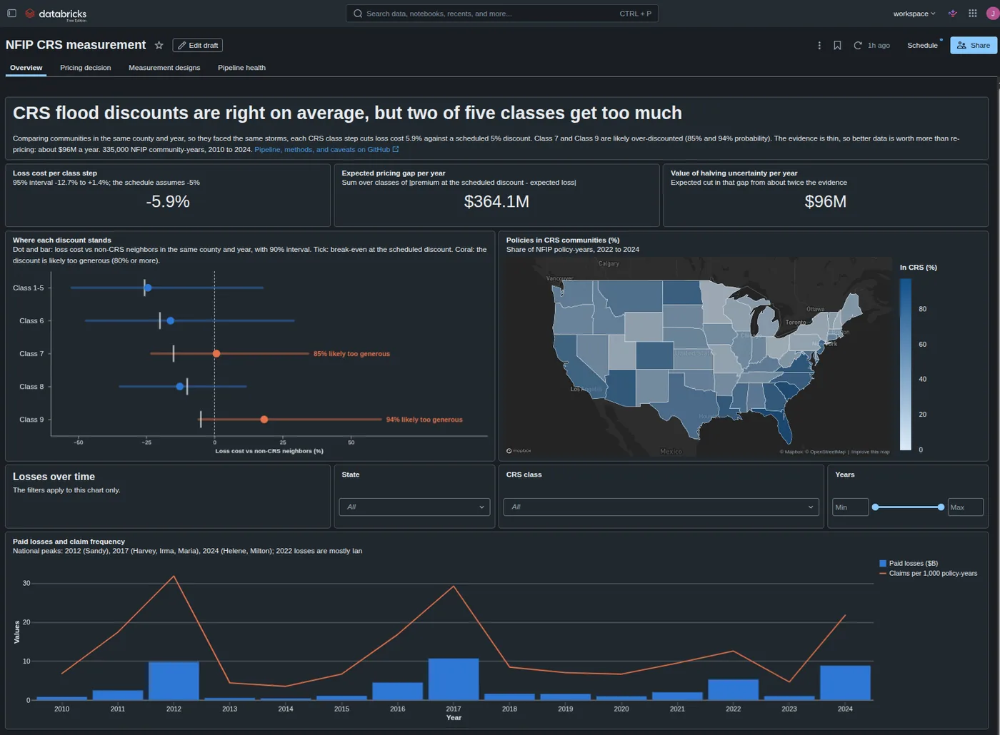
  <span class="figure-count">4 figures</span>
</a>
<a class="lightbox" href="assets/img/projects/nfip-crs-designs.webp" data-gallery="nfip-crs" data-description="Measurement designs: detectable effect for the observational design and a proposed randomized trial, and the placebo check that dropped the biased original design." hidden aria-hidden="true"></a>
<a class="lightbox" href="assets/img/projects/nfip-crs-job.webp" data-gallery="nfip-crs" data-description="The Databricks job: load silver, build gold, run quality checks, and run the analysis, on serverless compute." hidden aria-hidden="true"></a>
<a class="lightbox" href="assets/img/projects/nfip-crs-lineage.webp" data-gallery="nfip-crs" data-description="Unity Catalog lineage for the gold panel: three silver sources, and the dashboard, notebooks, and job that read it." hidden aria-hidden="true"></a>
```

<p class="project-type">Data engineering · Databricks · Causal inference</p>

### NFIP CRS Measurement

A national community-year panel built from about 75 million FEMA flood insurance policy records and 2.7 million claims, used to test whether Community Rating System discounts match the losses they prevent. Gold, quality checks, and the analysis run as a Databricks job.

<div class="project-result"><span>Key finding</span><strong>Discounts are right on average: each class step lowers loss cost 5.9% against a scheduled 5%. By class, the Class 7 and Class 9 discounts are 85% and 94% likely too generous, and placebo tests showed the causal effect of joining CRS cannot be measured with public data.</strong></div>

<p class="project-tools">Databricks · PySpark · Delta Lake · MLflow · DuckDB · Python</p>

[View repository →](https://github.com/JacobWillson13/nfip-crs-measurement)
:::

::: {.project-card}
```{=html}
<a class="project-figure lightbox" href="assets/img/projects/saas-stream.webp" data-gallery="saas-stream" data-description="Live Grafana dashboard during a seeded take: event throughput, active accounts, failed payments, and outlier flags.">
  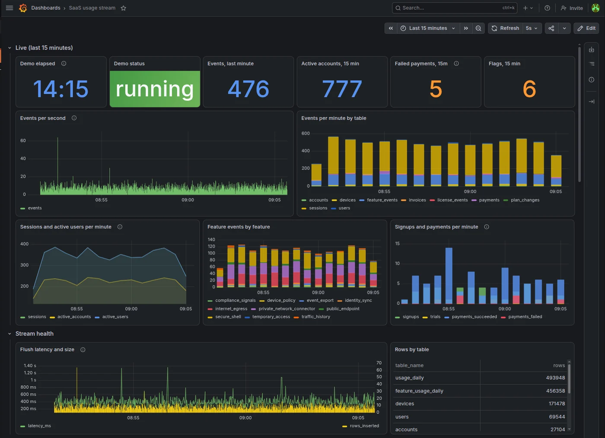
  <span class="figure-count">3 figures</span>
</a>
<a class="lightbox" href="assets/img/projects/saas-stream-outliers.webp" data-gallery="saas-stream" data-description="Outlier flags by type, recall against injected anomalies, and rolling trial-model metrics." hidden aria-hidden="true"></a>
<a class="lightbox" href="assets/img/projects/saas-stream-erd.webp" data-gallery="saas-stream" data-description="App schema: eleven tables centered on accounts, linked by 16 foreign keys." hidden aria-hidden="true"></a>
```

<p class="project-type">Streaming analytics · Azure · Anomaly detection</p>

### SaaS Usage Streaming on Azure

A real-time pipeline streaming about 500 events per minute into Azure PostgreSQL, with live outlier detection, an online trial-conversion model, and a 42-panel Managed Grafana dashboard.

<div class="project-result"><span>Key finding</span><strong>Duplicate payments and negative invoices were caught at 1.00 recall and precision, about 2.5 seconds after landing. A first-pass 0.71 AUC for trial conversion turned out to be label leakage; the corrected holdout AUC is 0.54.</strong></div>

<p class="project-tools">Python · PostgreSQL · Azure · Grafana · SQL</p>

[View repository →](https://github.com/JacobWillson13/saas-usage-stream-azure)
:::
::: {.project-card}
```{=html}
<a class="project-figure lightbox" href="assets/img/projects/retail-sql.webp" data-gallery="retail-sql" data-description="Yearly sales indexed to 1992, log scale: e-commerce and warehouse clubs grow while department and book stores fall below their 1992 level.">
  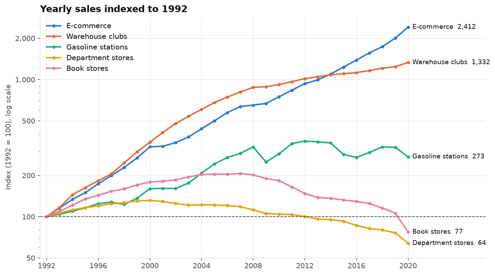
  <span class="figure-count">3 figures</span>
</a>
<a class="lightbox" href="assets/img/projects/retail-sql-ecom.webp" data-gallery="retail-sql" data-description="E-commerce against department stores: e-commerce passed department stores in 2007." hidden aria-hidden="true"></a>
<a class="lightbox" href="assets/img/projects/retail-sql-forecast.webp" data-gallery="retail-sql" data-description="Department store sales, actual and forecast to 2023 by method, with the 95% interval for the linear model." hidden aria-hidden="true"></a>
```

<p class="project-type">SQL analytics · Time series · Forecasting</p>

### U.S. Retail Sales Time Series in SQL

Twenty-nine years of U.S. Census retail data analyzed in PostgreSQL, with window functions, change-point detection, and three-year forecasts with prediction intervals and a backtest.

<div class="project-result"><span>Key finding</span><strong>E-commerce grew 11.7% a year from 1992 to 2019, against 4.2% for all retail, and passed department stores in 2007. Department stores peaked in 2000 and declined in 19 of the next 20 years.</strong></div>

<p class="project-tools">PostgreSQL · SQL · Python · pandas · Jupyter</p>

[View repository →](https://github.com/JacobWillson13/retail-sales-timeseries-sql)
:::

::::
:::::

::::: {#decision-science .project-group}
## Experimentation and Decision Science

:::: {.project-grid .project-grid-wide}
::: {.project-card}
```{=html}
<a class="project-figure lightbox" href="assets/img/projects/stockout.webp" data-gallery="stockout" data-description="Share of alerts that are real stockouts at each daily review capacity, model vs best baseline, on the held-out test week.">
  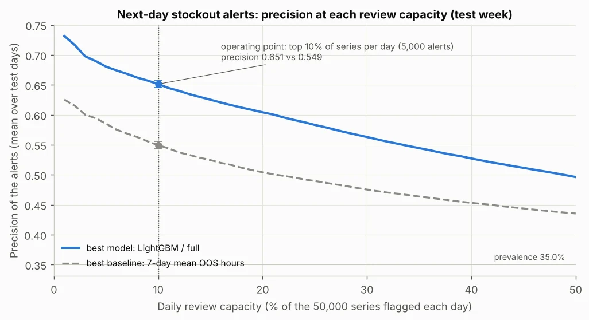
  <span class="figure-count">3 figures</span>
</a>
<a class="lightbox" href="assets/img/projects/stockout-by-hour.webp" data-gallery="stockout" data-description="Stockout rate by hour of day, overall and by category: low in the morning, about 40% by closing and overnight." hidden aria-hidden="true"></a>
<a class="lightbox" href="assets/img/projects/stockout-shap.webp" data-gallery="stockout" data-description="SHAP summary for the final model: other stores' stockouts and late-night empty shelves rank highest." hidden aria-hidden="true"></a>
```

<p class="project-type">Predictive modeling · Retail · Model evaluation</p>

### Next-Day Stockout Alerts

A model that ranks 50,000 perishable store-product series each evening by their risk of running out tomorrow, built on a SQL feature pipeline and evaluated with a rolling backtest and store-level bootstrap intervals.

<div class="project-result"><span>Key finding</span><strong>At 5,000 alerts a day, 65.1% were real stockouts against 54.9% for the best simple baseline, driven mostly by the same product running out in other stores. It catches about 19% of next-day stockouts at that capacity, so it works as a ranking aid.</strong></div>

<p class="project-tools">Python · SQL · DuckDB · LightGBM · SHAP · pytest</p>

[View repository →](https://github.com/JacobWillson13/freshretail-stockout-prediction)
:::

::: {.project-card}
```{=html}
<a class="project-figure lightbox" href="assets/img/projects/freight-broker.webp" data-gallery="freight-broker" data-description="Broker authority retention by entry cohort: Kaplan-Meier estimates with 95% confidence bands.">
  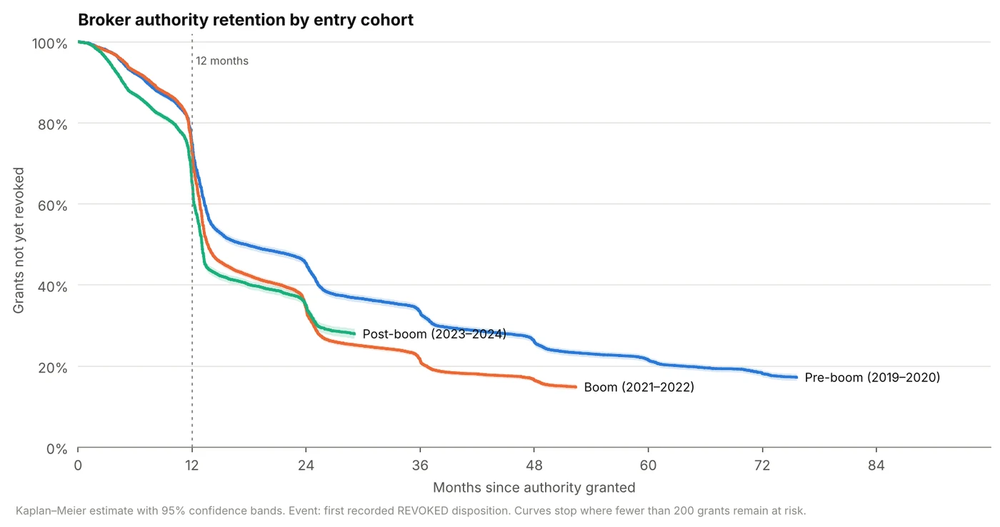
  <span class="figure-count">3 figures</span>
</a>
<a class="lightbox" href="assets/img/projects/freight-broker-entry.webp" data-gallery="freight-broker" data-description="New broker authorities granted per month, 2018 to 2025: the boom-era surge and the collapse after it." hidden aria-hidden="true"></a>
<a class="lightbox" href="assets/img/projects/freight-broker-hazard.webp" data-gallery="freight-broker" data-description="Monthly revocation hazard since grant, with spikes at each annual anniversary." hidden aria-hidden="true"></a>
```

<p class="project-type">Survival analysis · Public data · Market analysis</p>

### Freight Broker Boom and Bust

A survival analysis of 99,281 FMCSA broker authority records from 2018 to 2025, using a from-scratch Kaplan-Meier estimator validated against lifelines and DuckDB SQL checked against pandas.

<div class="project-result"><span>Key finding</span><strong>Broker grants nearly doubled to 8,877 in 2022, then fell 38% from 2023 to 2024. Boom-era authorities stayed unrevoked 2.2 fewer months on average over their first three years than pre-boom entrants, and revocations spike at every anniversary.</strong></div>

<p class="project-tools">Python · SQL · DuckDB · lifelines · pandas</p>

[View repository →](https://github.com/JacobWillson13/freight-broker-boom-bust)
:::

::: {.project-card}
```{=html}
<a class="project-figure lightbox" href="assets/img/projects/freight.webp" data-gallery="freight" data-description="Load vs cost per km: raw correlation of 0.030, and 0.991 once compared within route, month, and hour.">
  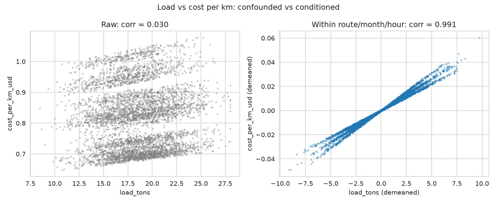
  <span class="figure-count">3 figures</span>
</a>
<a class="lightbox" href="assets/img/projects/freight-peak-hours.webp" data-gallery="freight" data-description="Peak hours cut mean speed and raise driver cost per km, while fuel intensity stays flat." hidden aria-hidden="true"></a>
<a class="lightbox" href="assets/img/projects/freight-clusters.webp" data-gallery="freight" data-description="Route segments on the first two principal components, colored by cluster and by terrain." hidden aria-hidden="true"></a>
```

<p class="project-type">Decision science · Sampling · Segmentation</p>

### Freight Cost & Sampling Analysis

A 500,000-trip synthetic freight network used to test sampling designs, cost drivers, and confounding controls against a fully known population.

<div class="project-result"><span>Key finding</span><strong>Like-for-like controls increased the observed load–cost correlation from 0.030 to 0.991.</strong></div>

<p class="project-tools">Python · pandas · Statistical analysis · Data visualization</p>

[View repository →](https://github.com/JacobWillson13/freight-cost-analysis)
:::

::: {.project-card}
```{=html}
<a class="project-figure lightbox" href="assets/img/projects/gemma4.webp" data-gallery="gemma4" data-description="Accuracy lift from oracle context, in percentage points, by model, question difficulty, and thinking mode.">
  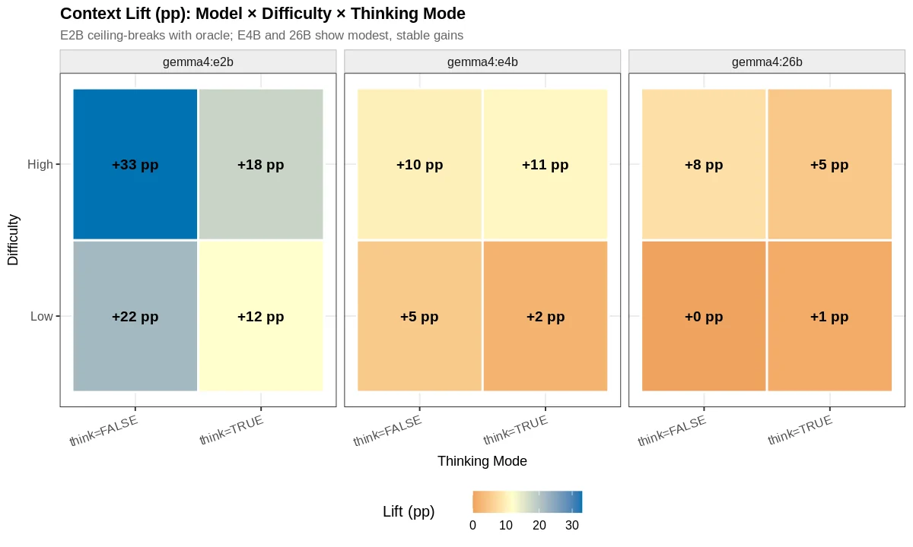
  <span class="figure-count">3 figures</span>
</a>
<a class="lightbox" href="assets/img/projects/gemma4-pareto.webp" data-gallery="gemma4" data-description="Accuracy vs median latency on a log scale: the deployment trade-off across models and thinking modes." hidden aria-hidden="true"></a>
<a class="lightbox" href="assets/img/projects/gemma4-accuracy.webp" data-gallery="gemma4" data-description="Accuracy by model, supplied context, and thinking mode, with 95% confidence ribbons." hidden aria-hidden="true"></a>
```

<p class="project-type">Experimental design · LLM evaluation · Deployment</p>

### Gemma 4 Security-Advisory Evaluation

A factorial experiment across 3,900 local inference runs measuring how model size, supplied evidence, thinking mode, and temperature affect accuracy and latency on security-advisory questions.

<div class="project-result"><span>Key finding</span><strong>Oracle context lifted the smallest model by up to 33 points on hard questions. E4B with thinking off reached 93.8% at 0.44 s median latency; 26B led at 95.6% but took 7.08 s, about 16 times longer.</strong></div>

<p class="project-tools">Python · R · Ollama · Factorial design · ANOVA</p>

[View repository →](https://github.com/JacobWillson13/gemma4-eval)
:::

::: {.project-card}
```{=html}
<a class="project-figure lightbox" href="assets/img/projects/uav.webp" data-gallery="uav" data-description="Best observed F1 for direct vs rolling generation across five architectures.">
  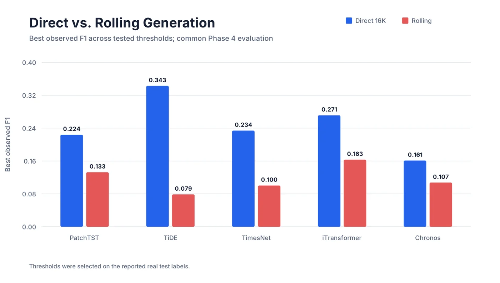
  <span class="figure-count">2 figures</span>
</a>
<a class="lightbox" href="assets/img/projects/uav-volume.webp" data-gallery="uav" data-description="Downstream F1 as synthetic volume grows from 16K to 64K rows: gains are selective, not automatic." hidden aria-hidden="true"></a>
```

<p class="project-type">Synthetic data · Time series · Predictive evaluation</p>

### Synthetic UAV Telemetry Evaluation

Seven synthetic time-series generators compared on two UAV datasets for statistical fidelity and train-synthetic/test-real utility.

<div class="project-result"><span>Key finding</span><strong>Every rolling-generation variant scored below its direct counterpart, cutting downstream F1 by 33% to 77% across five architectures. Matching class balance did not produce matching predictive structure.</strong></div>

<p class="project-tools">Python · PyTorch · GCP A100 · Time-series modeling</p>

[View repository →](https://github.com/JacobWillson13/uav-pnt)
:::

::: {.project-card}
```{=html}
<a class="project-figure lightbox" href="assets/img/projects/grateful-dead.webp" data-gallery="grateful-dead" data-description="Whole-song type-token ratio falls with length (rho = -0.41); a 50-word moving window removes most of that (rho = +0.19).">
  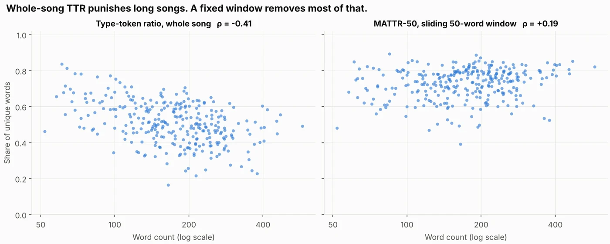
  <span class="figure-count">3 figures</span>
</a>
<a class="lightbox" href="assets/img/projects/grateful-dead-groups.webp" data-gallery="grateful-dead" data-description="The 50 most-played songs vs the rest: longer and more repetitive, with equally varied vocabulary." hidden aria-hidden="true"></a>
<a class="lightbox" href="assets/img/projects/grateful-dead-topics.webp" data-gallery="grateful-dead" data-description="Seven NMF topics on TF-IDF, stable across ten random seeds." hidden aria-hidden="true"></a>
```

<p class="project-type">NLP · Text statistics · Topic modeling</p>

### Grateful Dead Lyric Analysis

Tests whether the Grateful Dead's 50 most-played songs are lyrically simpler than the rest of a 309-song lyric archive, using length-robust vocabulary measures, weighted log-odds, and NMF topics.

<div class="project-result"><span>Key finding</span><strong>The most-played songs look simpler on type-token ratio only because they are longer and repeat more lines; on MATTR-50 their vocabulary is just as varied (p = 0.73). What differs is subject matter: trains and the road, not reflection.</strong></div>

<p class="project-tools">Python · scikit-learn · SciPy · NMF · TF-IDF</p>

[View repository →](https://github.com/JacobWillson13/grateful-dead-lyric-analysis)
:::

::::
:::::

::::: {#applied-ai .project-group}
## Applied AI and Information Systems

:::: {.project-grid .project-grid-wide}
::: {.project-card}
```{=html}
<a class="project-figure lightbox" href="assets/img/projects/scio.webp" data-gallery="scio" data-description="Adjusted Rand Index: three empirical partitions agree 2 to 3 times more with each other than with the theoretical branches.">
  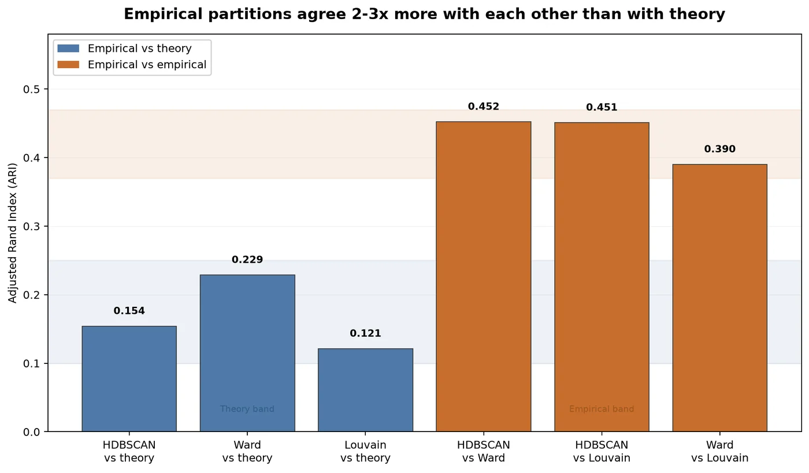
  <span class="figure-count">2 figures</span>
</a>
<a class="lightbox" href="assets/img/projects/scio-anchors.webp" data-gallery="scio" data-description="Anchor validity by branch: 92 of 106 testable features recovered, an overall hit rate of 0.868." hidden aria-hidden="true"></a>
```

<p class="project-type">NLP · Ontology validation · Research methods</p>

### SCIO Ontology Validation

Validation of a 121-feature influence-technique ontology using literature scoring, LLM-assisted coding, embeddings, clustering, and structured human review.

<div class="project-result"><span>Key finding</span><strong>Three clustering methods agreed with each other 2 to 3 times more than with the theoretical branches (ARI 0.39 to 0.45 vs 0.12 to 0.23). The features hold up as analytical units; the branches work as navigation, not as empirical classes.</strong></div>

<p class="project-tools">Python · Embeddings · HDBSCAN · NetworkX · Human review</p>

[View repository →](https://github.com/JacobWillson13/scio-eval)
:::

::: {.project-card}
```{=html}
<a class="project-figure lightbox" href="assets/img/projects/news-acquisition.webp" data-gallery="news-acquisition" data-description="Per-source outcome for the 26 sampled outlets, from complete text to not fetched.">
  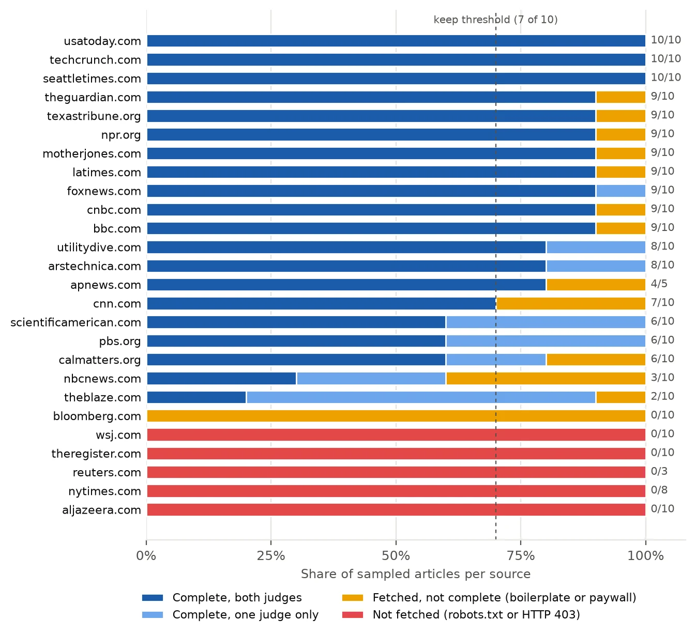
  <span class="figure-count">3 figures</span>
</a>
<a class="lightbox" href="assets/img/projects/news-acquisition-robots.webp" data-gallery="news-acquisition" data-description="Named AI crawlers are blocked far more often than this study's self-identified research agent." hidden aria-hidden="true"></a>
<a class="lightbox" href="assets/img/projects/news-acquisition-pipeline.webp" data-gallery="news-acquisition" data-description="The pipeline: Media Cloud discovery, polite fetching, Trafilatura extraction, and two Gemini judges." hidden aria-hidden="true"></a>
```

<p class="project-type">Data acquisition · LLM-as-judge · Responsible collection</p>

### News Acquisition Feasibility

A feasibility study testing whether Media Cloud and Trafilatura can supply complete article text from 30 U.S. news outlets, with a robots.txt-compliant crawler and two Gemini models judging completeness.

<div class="project-result"><span>Key finding</span><strong>62% to 72% of 246 sampled URLs yielded complete text, and 89% from the 14 best outlets, an upper bound since they were picked after seeing results. Losses came mostly from publisher access policy and page boilerplate, not discovery or extraction.</strong></div>

<p class="project-tools">Python · SQLite · Media Cloud · Trafilatura · Gemini · Pydantic</p>

[View repository →](https://github.com/JacobWillson13/news-acquisition-feasibility)
:::

::: {.project-card}
```{=html}
<a class="project-figure lightbox" href="assets/img/projects/dome-rag.webp" data-gallery="dome-rag" data-description="Answer-match rate by retrieval strategy in the 50-question pilot.">
  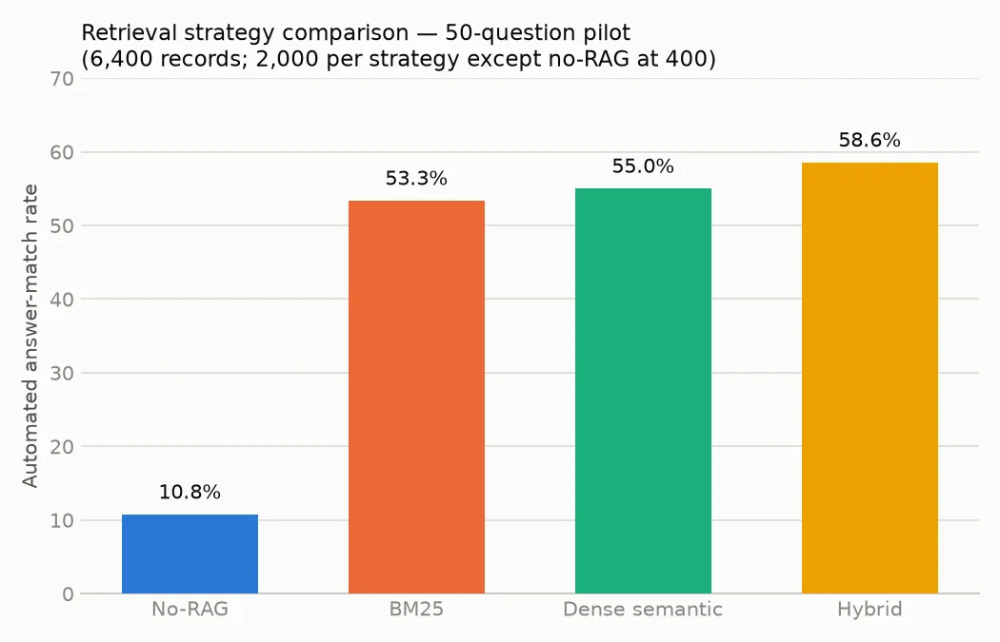
  <span class="figure-count">2 figures</span>
</a>
<a class="lightbox" href="assets/img/projects/dome-rag-latency.webp" data-gallery="dome-rag" data-description="Latency vs accuracy for every configuration, by retrieval strategy." hidden aria-hidden="true"></a>
```

<p class="project-type">RAG · Information retrieval · Evaluation</p>

### DOME Handbook RAG

A local RAG system for an engineering handbook, plus two studies comparing retrieval strategies, embeddings, and language models across 6,672 question-level records.

<div class="project-result"><span>Key finding</span><strong>Hybrid retrieval reached a 58.6% answer-match rate against 10.8% with no retrieval, and the best single configurations reached 70%.</strong></div>

<p class="project-tools">LangChain · ChromaDB · BM25 · Ollama · Gradio</p>

[View repository →](https://github.com/JacobWillson13/dome-rag)
:::

::: {.project-card}
```{=html}
<a class="project-figure lightbox" href="assets/img/projects/citebench.webp" data-gallery="citebench" data-description="Benchmark design: six extraction strategies normalized to one output schema and scored against silver labels.">
  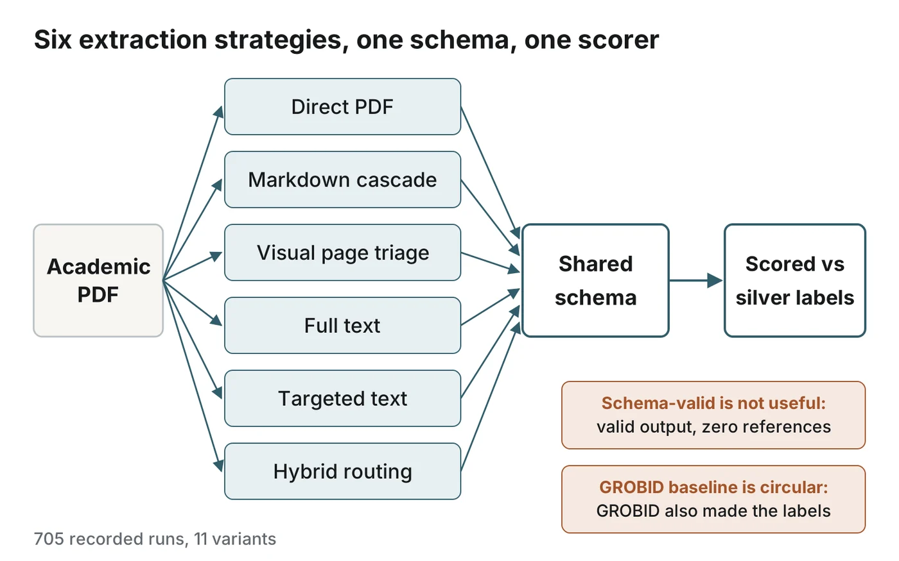
</a>
```

<p class="project-type">Document intelligence · Benchmarking · Reproducibility</p>

### CiteBench

A benchmark comparing six citation-extraction strategies and two parser baselines on academic PDFs, under one output schema and one scorer.

<div class="project-result"><span>Key finding</span><strong>Schema-valid output was not the same as useful output: the hybrid workflow returned structurally valid responses with no references. The GROBID baseline's high agreement is circular, because GROBID also produced the labels.</strong></div>

<p class="project-tools">Python · PDF parsing · LLM evaluation · Schema validation</p>

[View repository →](https://github.com/JacobWillson13/citebench)
:::

::: {.project-card}
```{=html}
<a class="project-figure lightbox" href="assets/img/projects/agentic-workflow.webp" data-gallery="agentic-workflow" data-description="Planning and execution separated by an approved project brief, with five human approval gates.">
  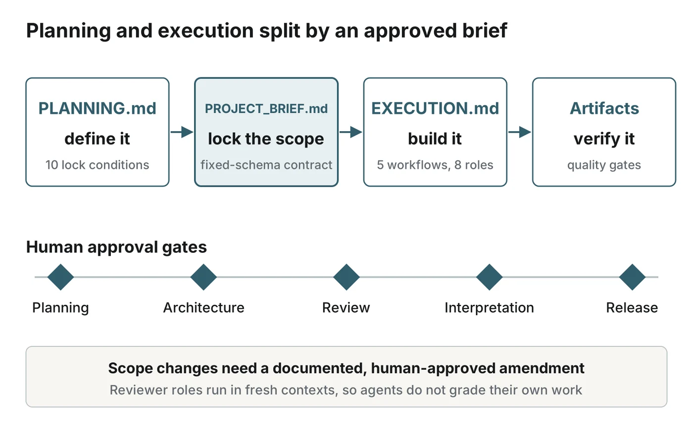
</a>
```

<p class="project-type">Agentic systems · Quality gates · Reproducibility</p>

### Agentic Development Workflow

A file-based methodology for running analytics and AI projects with coding agents, where an approved project brief separates planning from execution.

<div class="project-result"><span>Design</span><strong>Ten lock conditions gate planning; eight agent roles and five workflows run execution; reviewer roles work in fresh contexts so agents do not grade their own output.</strong></div>

<p class="project-tools">AI agents · Human in the loop · Project planning · Documentation</p>

[View repository →](https://github.com/JacobWillson13/agentic-dev-workflow)
:::

::: {#wasted-momentum .project-card}
```{=html}
<a class="project-figure lightbox" href="assets/img/projects/wasted-momentum-title.webp" data-gallery="wasted-momentum" data-description="Title slide of the pitch deck, first place at the 2025 SUNY Polytechnic Institute Elevator Pitch Competition.">
  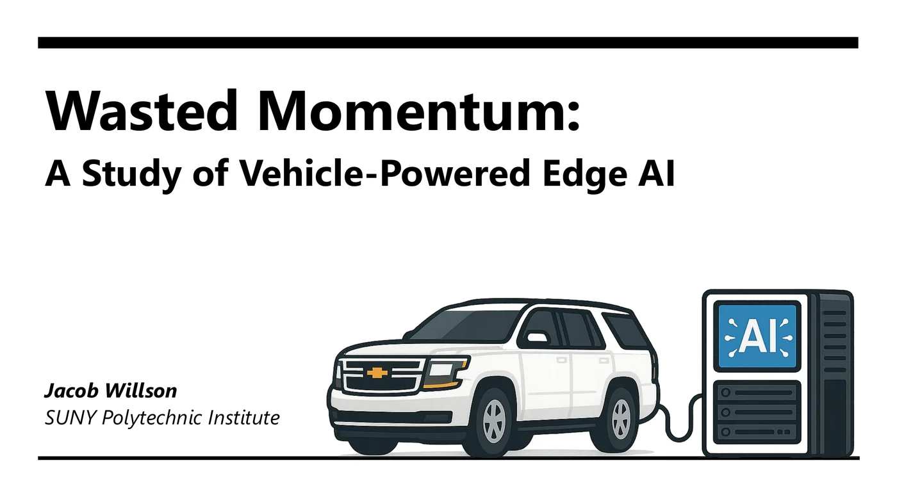
  <span class="figure-count">3 figures</span>
</a>
<a class="lightbox" href="assets/img/projects/wasted-momentum-screening.webp" data-gallery="wasted-momentum" data-description="Deployment screening from the white paper: seven deployment classes scored on five criteria." hidden aria-hidden="true"></a>
<a class="lightbox" href="assets/img/projects/wasted-momentum-power.webp" data-gallery="wasted-momentum" data-description="From the pitch deck: vehicle electrical loads compared with edge AI hardware draw." hidden aria-hidden="true"></a>
```

<p class="project-type">Edge AI · Feasibility study · Research proposal</p>

### Wasted Momentum: Vehicle-Powered Edge AI

A feasibility framework and six-month validation plan for running AI inference on vehicle power in places centralized compute cannot reach.

<div class="project-result"><span>Core argument</span><strong>Vehicle power is not cheaper than grid power, so the case is compute availability. Emergency response, defense, remote inspection, and agriculture screen as strong fits; rideshare and consumer fleets rank last.</strong></div>

<p class="project-tools">First place, 2025 SUNY Polytechnic Institute Elevator Pitch Competition</p>

[White paper (PDF) →](assets/pdf/wasted-momentum-white-paper.pdf){.pdf-link} [Pitch deck (PDF) →](assets/pdf/wasted-momentum-pitch-deck.pdf){.pdf-link}
:::
::::
:::::

::::::

:::::: {.section-shell .contact-section}
::: {.contact-band}
<div>
  <h2>Contact</h2>
  <p>Email is the fastest way to reach me: <a href="mailto:Jacob.Willson13@gmail.com">Jacob.Willson13@gmail.com</a></p>
</div>

<div class="contact-actions">
  <a class="btn btn-primary" href="mailto:Jacob.Willson13@gmail.com">Email</a>
  <a class="btn btn-outline-dark" href="https://www.linkedin.com/in/jacob-j-willson/">LinkedIn</a>
  <a class="btn btn-outline-dark" href="https://github.com/JacobWillson13">GitHub</a>
</div>
:::
::::::
