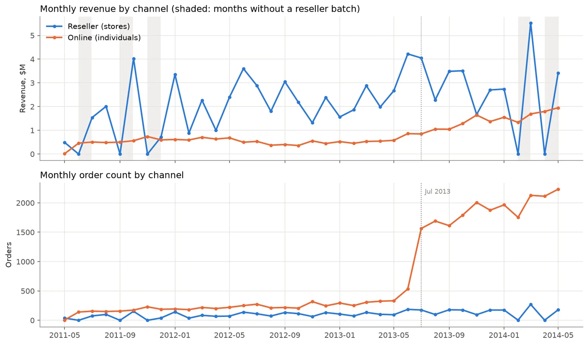
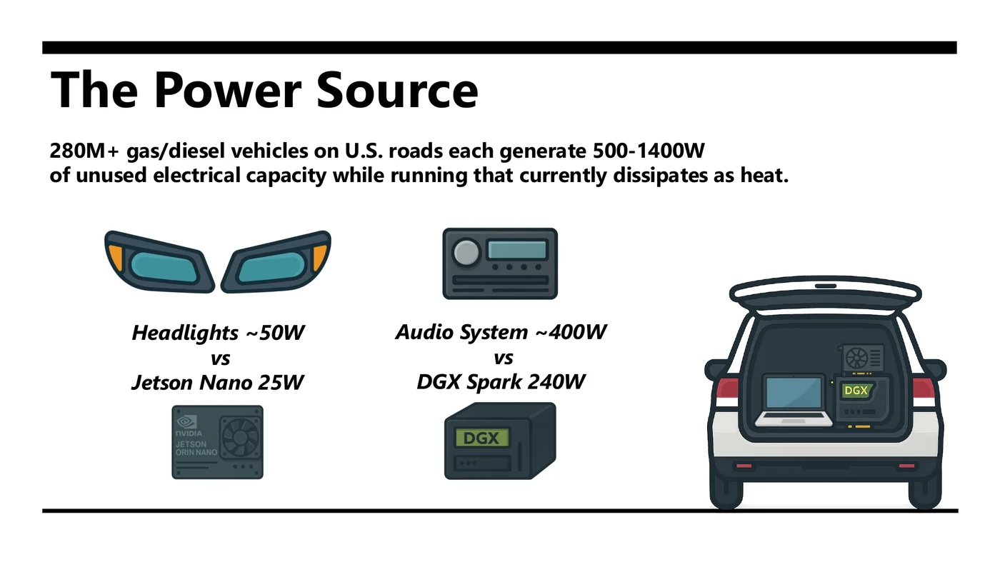

::: {.page-lede}
These projects show how I frame analytical questions, build reproducible workflows, evaluate evidence, and translate technical results into practical conclusions. Each repository includes methods, retained results, and documentation for closer review. Select any figure to enlarge it and page through the rest.
:::

## Analytics Engineering and Data Platforms

:::: {.project-grid .project-grid-wide}
::: {.project-card}
```{=html}
<a class="project-figure lightbox" href="assets/img/projects/seats-to-cash.webp" data-gallery="seats-to-cash" data-description="Streamlit app: month-end ARR, 2026 ARR movements by type, and billings vs revenue vs cash.">
  
  <span class="figure-count">3 figures</span>
</a>
<a class="lightbox" href="assets/img/projects/seats-to-cash-lineage.webp" data-gallery="seats-to-cash" data-description="dbt lineage from Orb, Stripe, and Salesforce sources to the ARR marts." hidden aria-hidden="true"></a>
<a class="lightbox" href="assets/img/projects/seats-to-cash-hightouch.webp" data-gallery="seats-to-cash" data-description="Hightouch sync of the account-signals model to the Salesforce Account object." hidden aria-hidden="true"></a>
```

<p class="project-type">Analytics engineering · Financial data · Reconciliation</p>

### Seats-to-Cash

Built a dbt and Snowflake finance stack on synthetic Orb, Stripe, and Salesforce data that separates ARR expansion from repricing, reconciles billings, revenue, deferred revenue, and cash, and syncs account signals to Salesforce via Hightouch.

<div class="project-result"><span>Key finding</span><strong>15.7% of 2026 ARR growth was repricing rather than expansion, with every MRR and revenue figure matching the answer key to the cent.</strong></div>

<p class="project-tools">dbt · Snowflake · DuckDB · Hightouch · Streamlit · LookML</p>

[View repository →](https://github.com/JacobWillson13/seats-to-cash)
:::

::: {.project-card}
```{=html}
<a class="project-figure lightbox" href="assets/img/projects/adventureworks.webp" data-gallery="adventureworks" data-description="Monthly revenue and orders by channel. Shaded months had no reseller batch; the July 2013 online expansion shows in order counts.">
  
  <span class="figure-count">4 figures</span>
</a>
<a class="lightbox" href="assets/img/projects/adventureworks-dashboard.webp" data-gallery="adventureworks" data-description="Overview page of the five-page Databricks AI/BI dashboard, deployed from JSON in the repository." hidden aria-hidden="true"></a>
<a class="lightbox" href="assets/img/projects/adventureworks-margin.webp" data-gallery="adventureworks" data-description="Gross margin over time: total, by category, and by channel, from cost history joined by effective date." hidden aria-hidden="true"></a>
<a class="lightbox" href="assets/img/projects/adventureworks-segments.webp" data-gallery="adventureworks" data-description="Customer segments: share of customers vs share of revenue, and recency vs value." hidden aria-hidden="true"></a>
```

<p class="project-type">Data engineering · Lakehouse · Analytics</p>

### AdventureWorks Lakehouse

Rebuilt a broken 72-file AdventureWorks export into a Databricks medallion lakehouse: PySpark bronze, a Lakeflow silver pipeline, a dbt star schema with 148 tests, five MLflow-tracked analyses, and a five-page AI/BI dashboard, all deployed as one Asset Bundle.

<div class="project-result"><span>Key finding</span><strong>Resellers bring about three quarters of revenue at a 0.6% gross margin, while online holds a steady 40%. Forecasting did not beat a naive baseline (49.0% vs 49.4% WAPE), and the write-up reports that rather than hiding it.</strong></div>

<p class="project-tools">Databricks · PySpark · Lakeflow · dbt · MLflow · AI/BI dashboards</p>

[View repository →](https://github.com/JacobWillson13/adventureworks-lakehouse)
:::

::: {.project-card}
```{=html}
<a class="project-figure lightbox" href="assets/img/projects/saas-stream.webp" data-gallery="saas-stream" data-description="Live Grafana dashboard during a seeded take: event throughput, active accounts, failed payments, and outlier flags.">
  
  <span class="figure-count">3 figures</span>
</a>
<a class="lightbox" href="assets/img/projects/saas-stream-outliers.webp" data-gallery="saas-stream" data-description="Outlier flags by type, recall against injected anomalies, and rolling trial-model metrics." hidden aria-hidden="true"></a>
<a class="lightbox" href="assets/img/projects/saas-stream-erd.webp" data-gallery="saas-stream" data-description="App schema: eleven tables centered on accounts, linked by 16 foreign keys." hidden aria-hidden="true"></a>
```

<p class="project-type">Streaming analytics · Azure · Anomaly detection</p>

### SaaS Usage Streaming on Azure

Streamed about 500 events per minute from simulated CRM, product, and payment systems into Azure Database for PostgreSQL, with live outlier detection, an online trial-conversion model, and a 42-panel Azure Managed Grafana dashboard refreshing every 5 seconds.

<div class="project-result"><span>Key finding</span><strong>Duplicate payments and negative invoices were caught at 1.00 recall and precision, about 2.5 seconds after landing. A first-pass 0.71 AUC for trial conversion turned out to be label leakage; the corrected holdout AUC is 0.54.</strong></div>

<p class="project-tools">Python · PostgreSQL · Azure · Grafana · SQL</p>

[View repository →](https://github.com/JacobWillson13/saas-usage-stream-azure)
:::
::::

## Experimentation and Decision Science

:::: {.project-grid .project-grid-wide}
::: {.project-card}
```{=html}
<a class="project-figure lightbox" href="assets/img/projects/freight.webp" data-gallery="freight" data-description="Load vs cost per km: raw correlation of 0.030, and 0.991 once compared within route, month, and hour.">
  
  <span class="figure-count">3 figures</span>
</a>
<a class="lightbox" href="assets/img/projects/freight-peak-hours.webp" data-gallery="freight" data-description="Peak hours cut mean speed and raise driver cost per km, while fuel intensity stays flat." hidden aria-hidden="true"></a>
<a class="lightbox" href="assets/img/projects/freight-clusters.webp" data-gallery="freight" data-description="Route segments on the first two principal components, colored by cluster and by terrain." hidden aria-hidden="true"></a>
```

<p class="project-type">Decision science · Sampling · Segmentation</p>

### Freight Cost & Sampling Analysis

Analyzed a 500,000-trip synthetic U.S. freight network using sampling simulation, route-level business intelligence, cost-driver analysis, confounding controls, and operational segmentation.

<div class="project-result"><span>Key finding</span><strong>Like-for-like controls increased the observed load–cost correlation from 0.030 to 0.991.</strong></div>

<p class="project-tools">Python · pandas · Statistical analysis · Data visualization</p>

[View repository →](https://github.com/JacobWillson13/freight-cost-analysis)
:::

::: {.project-card}
```{=html}
<a class="project-figure lightbox" href="assets/img/projects/gemma4.webp" data-gallery="gemma4" data-description="Accuracy lift from oracle context, in percentage points, by model, question difficulty, and thinking mode.">
  
  <span class="figure-count">3 figures</span>
</a>
<a class="lightbox" href="assets/img/projects/gemma4-pareto.webp" data-gallery="gemma4" data-description="Accuracy vs median latency on a log scale: the deployment trade-off across models and thinking modes." hidden aria-hidden="true"></a>
<a class="lightbox" href="assets/img/projects/gemma4-accuracy.webp" data-gallery="gemma4" data-description="Accuracy by model, supplied context, and thinking mode, with 95% confidence ribbons." hidden aria-hidden="true"></a>
```

<p class="project-type">Experimental design · LLM evaluation · Deployment</p>

### Gemma 4 Security-Advisory Evaluation

Designed and analyzed a controlled local experiment measuring how model size, supplied evidence, reasoning configuration, and temperature affect accuracy, latency, reliability, and deployment trade-offs across 3,900 inference runs.

<div class="project-result"><span>Key finding</span><strong>Oracle context lifted the smallest model by up to 33 points on hard questions. E4B with thinking off reached 93.8% at 0.44 s median latency; 26B led at 95.6% but took 7.08 s, about 16 times longer.</strong></div>

<p class="project-tools">Python · R · Ollama · Factorial design · ANOVA</p>

[View repository →](https://github.com/JacobWillson13/gemma4-eval)
:::

::: {.project-card}
```{=html}
<a class="project-figure lightbox" href="assets/img/projects/uav.webp" data-gallery="uav" data-description="Best observed F1 for direct vs rolling generation across five architectures.">
  
  <span class="figure-count">2 figures</span>
</a>
<a class="lightbox" href="assets/img/projects/uav-volume.webp" data-gallery="uav" data-description="Downstream F1 as synthetic volume grows from 16K to 64K rows: gains are selective, not automatic." hidden aria-hidden="true"></a>
```

<p class="project-type">Synthetic data · Time series · Predictive evaluation</p>

### Synthetic UAV Telemetry Evaluation

Compared seven synthetic time-series generation approaches across two UAV datasets using statistical fidelity and train-synthetic/test-real evaluation.

<div class="project-result"><span>Key finding</span><strong>Every rolling-generation variant scored below its direct counterpart, cutting downstream F1 by 33% to 77% across five architectures. Matching class balance did not produce matching predictive structure.</strong></div>

<p class="project-tools">Python · PyTorch · GCP A100 · Time-series modeling</p>

[View repository →](https://github.com/JacobWillson13/uav-pnt)
:::

::: {.project-card}
```{=html}
<a class="project-figure lightbox" href="assets/img/projects/scio.webp" data-gallery="scio" data-description="Adjusted Rand Index: three empirical partitions agree 2 to 3 times more with each other than with the theoretical branches.">
  
  <span class="figure-count">2 figures</span>
</a>
<a class="lightbox" href="assets/img/projects/scio-anchors.webp" data-gallery="scio" data-description="Anchor validity by branch: 92 of 106 testable features recovered, an overall hit rate of 0.868." hidden aria-hidden="true"></a>
```

<p class="project-type">NLP · Ontology validation · Research methods</p>

### SCIO Ontology Validation

Combined literature validation, LLM-assisted evidence coding, embeddings, clustering, network analysis, and structured human review to evaluate a socio-cognitive influence ontology.

<div class="project-result"><span>Key finding</span><strong>Three clustering methods agreed with each other 2 to 3 times more than with the theoretical branches (ARI 0.39 to 0.45 vs 0.12 to 0.23). The features hold up as analytical units; the branches work as navigation, not as empirical classes.</strong></div>

<p class="project-tools">Python · Embeddings · HDBSCAN · NetworkX · Human review</p>

[View repository →](https://github.com/JacobWillson13/scio-eval)
:::
::::

## Applied AI and Information Systems

:::: {.project-grid .project-grid-wide}
::: {.project-card}
```{=html}
<a class="project-figure lightbox" href="assets/img/projects/dome-rag.webp" data-gallery="dome-rag" data-description="Answer-match rate by retrieval strategy in the 50-question pilot.">
  
  <span class="figure-count">2 figures</span>
</a>
<a class="lightbox" href="assets/img/projects/dome-rag-latency.webp" data-gallery="dome-rag" data-description="Latency vs accuracy for every configuration, by retrieval strategy." hidden aria-hidden="true"></a>
```

<p class="project-type">RAG · Information retrieval · Evaluation</p>

### DOME Handbook RAG

Built a local handbook question-answering application and two completed studies comparing retrieval strategies, embedding choices, and language models across 6,672 question-level records.

<div class="project-result"><span>Key finding</span><strong>Hybrid retrieval reached a 58.6% answer-match rate against 10.8% with no retrieval, and the best single configurations reached 70%.</strong></div>

<p class="project-tools">LangChain · ChromaDB · BM25 · Ollama · Gradio</p>

[View repository →](https://github.com/JacobWillson13/dome-rag)
:::

::: {.project-card}
```{=html}
<a class="project-figure lightbox" href="assets/img/projects/citebench.webp" data-gallery="citebench" data-description="Benchmark design: six extraction strategies normalized to one output schema and scored against silver labels.">
  
</a>
```

<p class="project-type">Document intelligence · Benchmarking · Reproducibility</p>

### CiteBench

Developed a reproducible benchmark comparing citation-extraction workflows across PDF, text, vision, targeted-context, hybrid, and specialist-parser approaches, with 705 recorded results across 11 variants.

<div class="project-result"><span>Key finding</span><strong>Schema-valid output was not the same as useful output: the hybrid workflow returned structurally valid responses with no references. The GROBID baseline's high agreement is circular, because GROBID also produced the labels.</strong></div>

<p class="project-tools">Python · PDF parsing · LLM evaluation · Schema validation</p>

[View repository →](https://github.com/JacobWillson13/citebench)
:::

::: {.project-card}
```{=html}
<a class="project-figure lightbox" href="assets/img/projects/agentic-workflow.webp" data-gallery="agentic-workflow" data-description="Planning and execution separated by an approved project brief, with five human approval gates.">
  
</a>
```

<p class="project-type">Agentic systems · Quality gates · Reproducibility</p>

### Agentic Development Workflow

Developed a human-governed framework for planning and executing analytics, data-science, and applied-AI projects with coding agents.

<div class="project-result"><span>Operating model</span><strong>Defined project intake, agent roles, decision trees, quality gates, and approval points to keep agent-assisted work auditable.</strong></div>

<p class="project-tools">AI agents · Human in the loop · Project planning · Documentation</p>

[View repository →](https://github.com/JacobWillson13/agentic-dev-workflow)
:::

::: {.project-card}
```{=html}
<a class="project-figure lightbox" href="assets/img/projects/wasted-momentum.webp" data-gallery="wasted-momentum" data-description="From the pitch deck: surplus electrical output in a running vehicle compared with edge AI hardware draw.">
  
  <span class="figure-count">2 figures</span>
</a>
<a class="lightbox" href="assets/img/projects/wasted-momentum-prototypes.webp" data-gallery="wasted-momentum" data-description="Prototype concept: an AI network distributed between two vehicles." hidden aria-hidden="true"></a>
```

<p class="project-type">Edge AI · Research proposal · Systems thinking</p>

### Wasted Momentum: Vehicle-Powered Edge AI

Developed a research proposal for powering distributed AI inference from surplus vehicle electrical output, supported by a literature review, white paper, and pitch deck.

<div class="project-result"><span>Recognition</span><strong>First-place entry in the 2025 SUNY Polytechnic Institute research pitch competition.</strong></div>

<p class="project-tools">Edge AI · Infrastructure · Research synthesis · Technical communication</p>

[View proposal summary →](cv.qmd#research-and-proposals)
:::
::::

::: {.project-note}
### Why the repositories matter

The project summaries are intentionally concise. The linked repositories retain the code, methods, results, documentation, and evidence boundaries needed for a technical review.
:::
